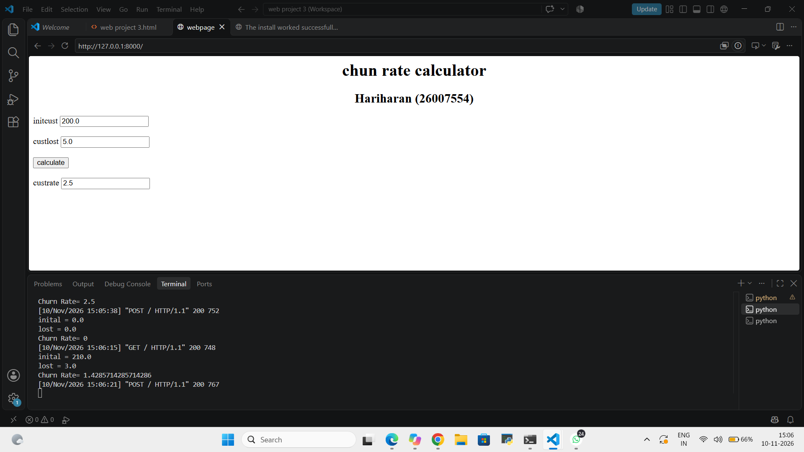
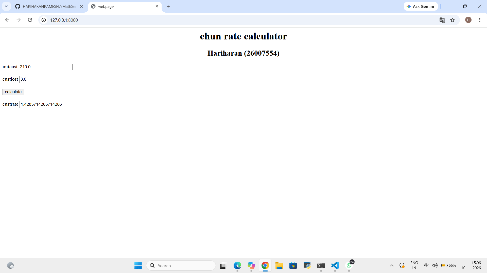

# Ex.03 Design a Website for Server Side Processing
## Date:10.11.2026

## AIM:
To create a web page to calculate Churn Rate using server-side scripts.

## FORMULA:
Churn Rate = (CustLost / InitCust) * 100
<br> InitCust --> Initial Customers Count
<br> CustLost --> Customers Lost Count

## DESIGN STEPS:

### Step 1:
Clone the repository from GitHub.

### Step 2:
Create Django Admin project.

### Step 3:
Create a New App under the Django Admin project.

### Step 4:
Create a HTML file to implement form based input and output.

### Step 5:
Create python programs for views and urls to perform server side processing.

### Step 6:
Receive input values from the form using request.POST.get().

### Step 7:
Calculate the Result using the given formula.

### Step 8:
Display the calculated result in the server console.

### Step 9:
Render the result to the HTML template.

### Step 10:
Publish the website in Localhost.

## PROGRAM:
```
math.html

<html>
    <head>
        <title>webpage</title>
    </head>
    <body>
        <h1 align="center">chun rate calculator</h1>
    <h2 align="center"> Hariharan (26007554)</h2>
        <form method="POST">
            
            <label>initcust</label>
            <input type="text" name="inital" value="{{h}}"></input> <br></br>
            <label>custlost</label>
            <input type="text" name="lost" value="{{a}}"></input> <br></br>
            <input type="submit" value="calculate"> </input> <br></br>
            <label>custrate</label>
            <input type="text" value={{ChurnRate}}></input>

        </form>
     </body>
</html>

views.py
from django.shortcuts import render
def churn_rate(request):
    h = float(request.POST.get('inital', '0'))
    a = float(request.POST.get('lost', '0'))
    ChurnRate = (a / h) * 100 if request.method == 'POST' else 0
    print("inital =",h)
    print("lost =",a)
    print("Churn Rate=",ChurnRate)
    return render(request, 'myapp/math.html',{'h': h, 'a': a, 'ChurnRate': ChurnRate})

urls.py
from django.contrib import admin
from django.urls import path
from myapp import views

urlpatterns = [path('', views.churn_rate, name='churn_rate'),]

```

## OUTPUT - SERVER SIDE:


## OUTPUT - WEBPAGE:


## RESULT:
The the web page to calculate Churn Rate using server-side scripts is created successfully.
